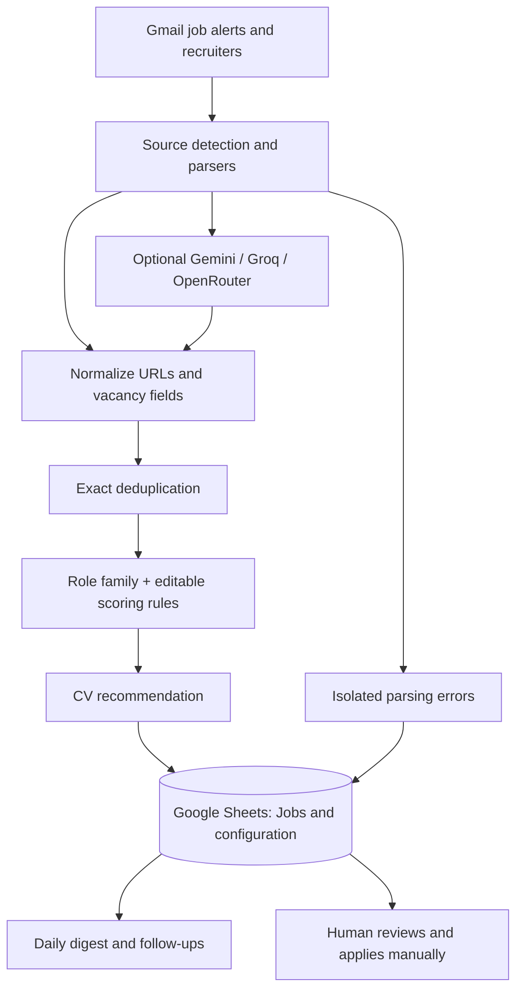

# JobOps — Data flow and operational boundaries

This is a **single-user Google Apps Script workflow**, not a scraping bot or a job-application automation platform. The root [README](../README.md) covers setup and the existing [PRD](PRD.md), [operations guide](OPERATIONS.md) and [test guide](TESTING.md) provide detail.

## Processing architecture

The optional AI step is for **multi-vacancy extraction and semantic classification**, not the authoritative scoring engine; returned data must pass local validation. If no provider is configured, do not infer that AI is necessary for normal processing. Gmail labels operate at the **thread** level, a distinct granularity from individual messages.

## Safety and deployment

- `dryRunIngestion()` inspects candidates without changing Gmail or Sheets; review it before `ingestJobs()`.
- `setupJobOps()` is intended to preserve existing user-configured values and manual fields.
- Triggers are not installed by CI or setup; they are explicitly installed with `installJobOpsTriggers()`.
- Local checks run via `npm run ci`. Production Apps Script updates are deployed **manually** through clasp.
- JobOps does not submit applications, message recruiters or browse job portals on the user's behalf.
- Script IDs, credentials, real resumes and message contents must remain private.

## Troubleshooting path

If expected vacancies do not appear, inspect ingestion counters, configured source patterns, parsing errors, Gmail thread labels and deduplication keys before modifying score rules. If a vacancy exists but is ranked unexpectedly, review `RoleFamilies`, `ScoringRules` and the result of `rescoreJobs()` without overwriting application status, notes or manual dates.

This diagram describes the documented workflow; implementation details and current configuration are authoritative in `src/` and the associated tests.
